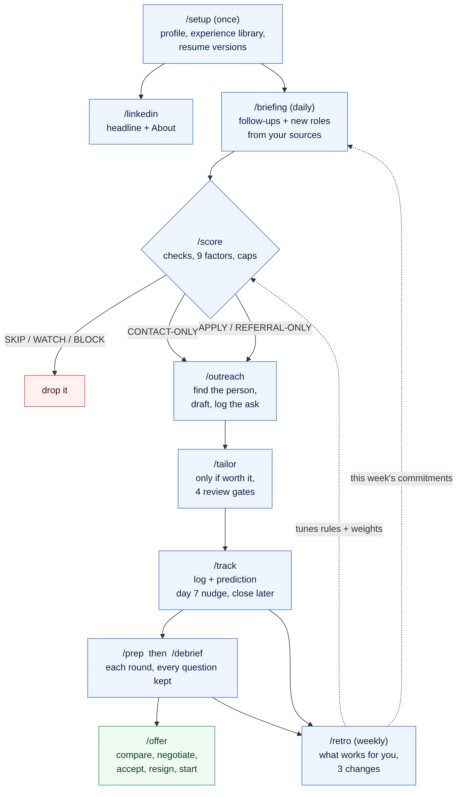
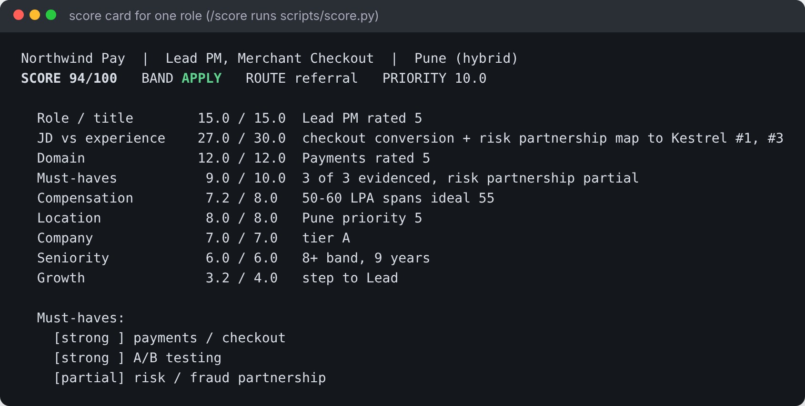
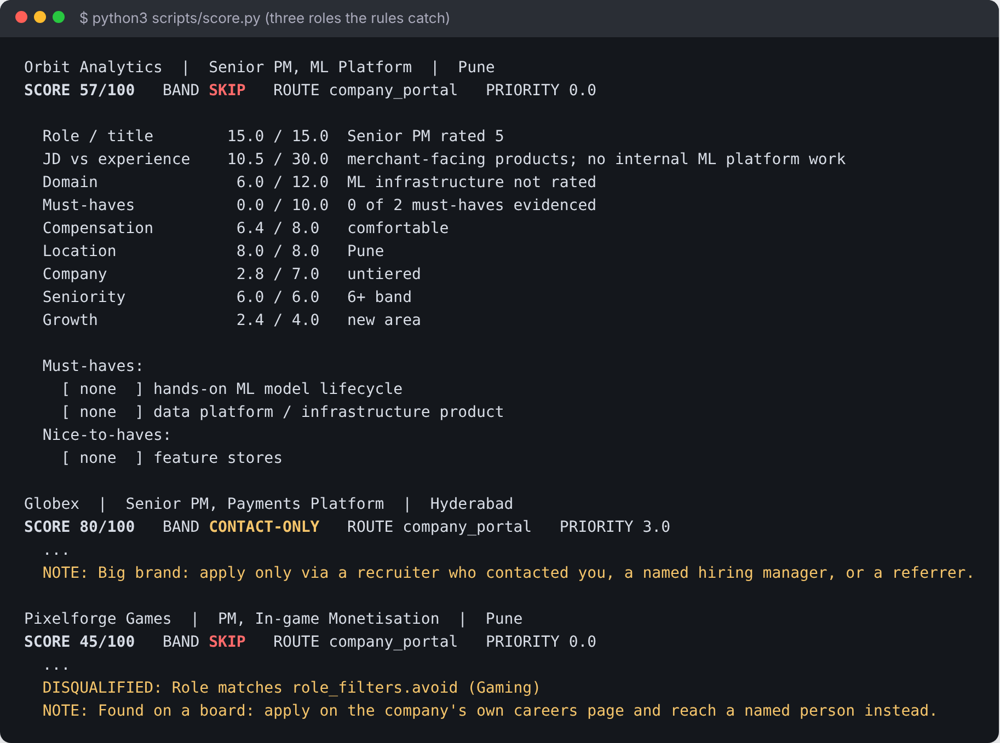
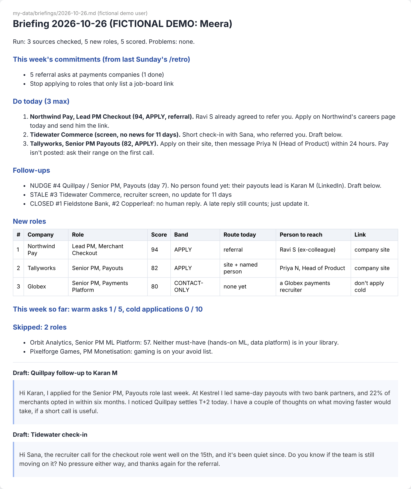
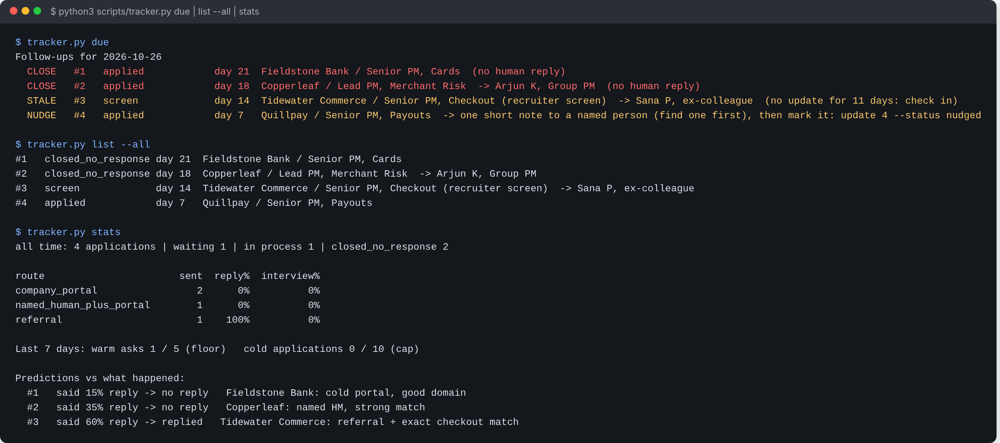
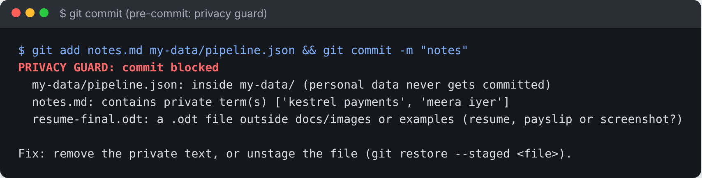

# CareerOS

A job-search kit you run with Claude. You set it up once with your own background and goals.
Then it helps you every day: which roles are worth your time, who to contact, what to send, how to
prepare, and what's actually working.

It grew out of real job-search work, so the defaults are practical lessons, not theory. The examples lean
product management, but the kit works for any office job: you set your own titles, industries, pay and rules.

Everything about you stays in a private folder on your computer.



---

## What it does, step by step

| Step | Command | What you get | Saved in `my-data/` |
|---|---|---|---|
| Set up (once) | `/setup` | Your preferences, a verified record of your experience, your resume versions | `profile.yaml`, `experience-library.md`, `resumes/` |
| Tidy your profile | `/linkedin` | LinkedIn headline and About rewritten for the roles you want | (chat) |
| Find roles | `/briefing` | Each morning: follow-ups due, new roles, ranked, 3 things to do today | `briefings/` |
| Judge a role | `/score` | A score out of 100, what's missing, and what to do: APPLY, REFERRAL-ONLY, CONTACT-ONLY or SKIP | `jds/`, `scores/` |
| Reach a person | `/outreach` | Who to contact and a short message in your voice | `contacts.md`, `asks.json` |
| Apply | `/tailor` | Resume and cover note, checked for truth, plus a send checklist | `applications/` |
| Keep track | `/track` | Every application with your prediction, day-7 nudges, stalled processes | `pipeline.json` |
| Interview | `/prep`, `/debrief` | Prep pack per round (screen, case, take-home, panel); grades and every question asked | `prep/`, `interview-log.md` |
| Offer | `/offer` | Offer breakdown, comparison, negotiation plan, references, resign and start checklist | `offers/` |
| Learn | `/retro` | Weekly: what's working for you, which rules to keep, next week's 3 changes | `retros/` |

**It never applies, sends or messages anyone for you.** It prepares; you click.

### Words you'll see

- **JD:** job description.
- **ATS:** the company's own application system (Greenhouse, Workday, Lever...), on its careers site.
- **Route:** how you reach the company. Referral, a named person, the company site, a job board.
- **Band:** what to do with a role. **APPLY**: go. **REFERRAL-ONLY**: only through someone who knows you or a named hiring manager. **CONTACT-ONLY**: find a person first, don't apply cold. **SKIP**: not worth your time. Also **WATCH** (no real JD yet) and **BLOCK** (you already applied).
- **Cap:** a limit on the score when the JD asks for something you can't show.
- **Gates:** four review passes on anything you send: truth, recruiter, hiring manager, voice.
- **Warm ask:** a referral request, or a note to a named hiring manager or recruiter.

---

## See it working in one minute

A made-up user, Meera (a payments product manager in Pune), is preloaded. Every name and company in the demo is invented.

**With a terminal:**
```bash
git clone https://github.com/subhasishgoswami02/careeros.git
cd careeros
python3 -m pip install --user pyyaml      # Windows: py -m pip install pyyaml
bash examples/demo/run_demo.sh            # Windows: run this in Git Bash or WSL
```

**Without a terminal:** open the folder in the Claude desktop app and say: *"Run examples/demo/run_demo.sh and show me the output."*

A score card. Every point has a written reason:



The rules at work. A big brand is contact-only, missing must-haves sink a role, and an off-list domain is skipped:



A morning briefing. Ranked by the best way in, not just by score:



Follow-ups, the pipeline, and the funnel by route:



---

## Set it up for yourself

Full walkthrough: **[docs/SETUP.md](docs/SETUP.md)**. Short version:

1. **You need a paid Claude plan** (Pro or above) and either the **Claude desktop app** (no terminal) or **Claude Code** (terminal).
2. **Get the folder.** On this page click **Code → Download ZIP** and unzip it. Or `git clone` it if you use git.
3. **Open it with Claude.** In the desktop app, start a task, choose the `careeros` folder, and type: *"Read CLAUDE.md, then run /setup."* In Claude Code: `cd careeros`, `claude`, then `/setup`.
4. **Answer the questions** (about 30 minutes). Have your resume and LinkedIn text ready to paste. Claude builds your private `my-data/` folder.
5. **Score one real job** with `/score`. Tomorrow morning, run `/briefing`.

Total first-time setup: about 45 minutes.

### Sharing it with a friend

Send them the link to this page. They download it and run `/setup` with their own details. Nothing of yours
travels with it, because your data lives only in your own `my-data/` folder, which is never uploaded.

---

## Make it yours

Four plain-text files hold every setting. `/setup` copies them into `my-data/`, where you change them.
You can also just tell Claude: *"make location matter more"* or *"turn off the big-brand rule"*.
Details: **[docs/CUSTOMIZE.md](docs/CUSTOMIZE.md)**.

| File | Controls |
|---|---|
| `profile.yaml` | Titles, industries, locations, pay, target companies, work authorization, your writing voice |
| `scoring.yaml` | 9 weighted factors, the bands, the caps |
| `rules.yaml` | What to do after scoring. Every rule can be switched off |
| `sources.yaml` | Where to look for roles: job-alert emails, company sites, boards, community sheets |

---

## The default rules, and why

These are starting points, not laws. `/retro` checks each one against **your** results
once you have about 30 applications, and tells you which to keep.

| Rule (on by default) | Why |
|---|---|
| Job boards and one-click "Easy Apply" are for finding roles; apply on the company's site and reach a person | One-click applications rarely reach a human |
| Very large brands: contact-only | Most applicants per role, longest to prepare; a person inside changes the odds |
| Roles in your niche go first | They convert far better than generic titles |
| At least 5 warm asks a week, at most 10 cold applications | A referral or a named person reaches a human far more often than a portal |
| One follow-up around day 7, then let it go | Keeps dead applications from looking active, and you from chasing |
| Ask the pay range on the first call, once they see a fit | A budget gap found after five rounds wastes everyone's time |
| The score shows fit, not your odds | Who you go through usually matters more than how well you fit |

## What it doesn't do (yet)

- **No applying or sending.** By design: job sites forbid it, and quality beats volume.
- **No automatic inbox reading.** It can read job-alert emails if you connect Gmail or Outlook to Claude, but it doesn't track recruiter replies for you. Update statuses with `/track`.
- **No live dashboard.** You get daily briefing files and `tracker.py stats`.
- **No salary database.** `/offer` works from your own numbers. Ask Claude to research a market range and it will cite sources and dates.
- **No mock-interview voice practice.** `/prep` gives you the questions and the beats of each answer. Practise them out loud with a friend or with Claude.
- **Signed-in job sites.** Reading LinkedIn, Naukri and similar sites while you're signed in can break their terms. The kit uses their alert emails instead and never visits those sites on a schedule.
- **Scheduling.** Easy in the desktop app (scheduled tasks). In Claude Code you set it up yourself (see SETUP).
- **Defaults lean product management and India.** `/setup` asks for your role family and market, and `/retro` tunes the rules to you.

---

## Your data stays yours



- Everything personal lives in `my-data/`, which git ignores, so it isn't uploaded even if you put your copy on GitHub.
- If you use git, `/setup` installs a check that **blocks any commit** containing `my-data/`, a resume, payslip or screenshot file, or any word in your `my-data/private-terms.txt` (your name, email, employer, pay). Git doesn't copy this check when you clone, so it gets installed once on each computer. `git commit --no-verify` skips it, so don't use that.
- If you downloaded the ZIP and never use git, nothing you write can end up online.
- `contacts.md` holds other people's work contact details. Keep it to work channels and clear it when your search ends.

---

## What's in the folder

```
careeros/
├── README.md            this page
├── CLAUDE.md            instructions Claude reads first
├── config/              default settings (yours go in my-data/)
├── .claude/skills/      the 11 commands
├── .claude/agents/      the 4 review gates
├── .claude/settings.json  lets Claude Code run the kit's scripts without asking each time
├── scripts/             score.py, tracker.py, privacy_guard.py, install_guard.sh
├── templates/my-data/   blank experience library, contacts, interview log
├── examples/demo/       Meera, the fictional user, end to end
├── docs/                SETUP, CUSTOMIZE, images, design notes
└── tests/               python3 tests/test_kit.py
```

## Design

The kit is built around a few ideas that matter whenever an AI helps with a high-stakes personal decision:

- **Truth before polish.** Every claim traces to one evidence file with a confidence level; a review gate with a veto checks it.
- **Judgment in prose, arithmetic in code.** Claude reads the JD and writes reasons; `score.py` does the maths, so totals can't drift.
- **Ordered review gates, not a committee.** Truth, recruiter, hiring manager, voice, each with a defined power, in that order.
- **Predictions before outcomes.** Every application carries a written prediction; `/retro` grades them, which is how a sample of one learns.
- **The human approves every external action.** Nothing is sent or submitted by the kit.
- **Private by construction.** Personal data lives in one git-ignored folder, with a commit guard as a second lock.

More in [docs/design/](docs/design/).

## Credits

Built by Subhasish Goswami for friends starting their own search, and shared for anyone else.
Some ideas sit alongside Aakash Gupta's *Job Search OS*, a separate paid product that isn't included here.
If you use it, the two work fine side by side.

MIT licence.
