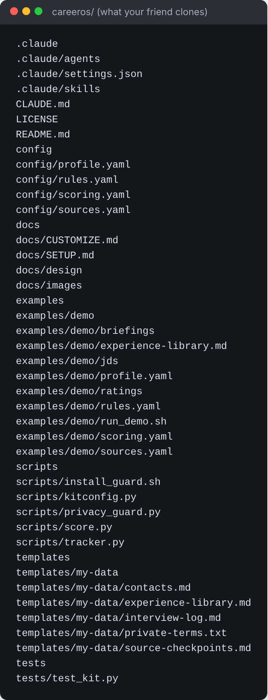

# Setup, step by step

About 45 minutes the first time: 15 to get it open, 30 answering questions.



## Before you start

- [ ] A paid Claude plan (Pro or above). The free plan doesn't include Claude Code.
- [ ] Your current resume (PDF, Word, or pasted text)
- [ ] Your LinkedIn About and Experience text (copy and paste)
- [ ] Anything that backs up your numbers: reviews, dashboards, launch notes, links to your work
- [ ] 2 or 3 job descriptions you're considering, to test with

---

## Path A: Claude desktop app (no terminal)

1. **Download the kit.** On the GitHub page, click the green **Code** button, then **Download ZIP**. Unzip it somewhere you'll keep it, like `Documents/careeros`.
2. **Install the Claude desktop app** from claude.ai/download and sign in.
3. **Start a task with the folder.** Choose the `careeros` folder when the app asks which folder to work in.
4. **Type:** `Read CLAUDE.md, then run /setup.`
5. **Answer the questions.** Claude asks a few at a time: your resume, then your stories, the roles you want, pay, target companies, and how you like to sound. It shows every file it writes, so check them.
6. **Check your numbers.** When Claude shows your experience library, read every number. If you couldn't defend one in an interview, tell Claude to mark it *Medium* or *Do-not-use*. This file keeps your resume honest.
7. **Try it.** Paste a job description and type `/score`.
8. **Make the briefing daily (optional).** Ask Claude: *"Schedule /briefing every weekday at 8:30am."* It runs as a scheduled task. Connect Gmail or Outlook in the app if you want it to read your job-alert emails.

Python: setup checks for it. On a Mac, the first `python3` may ask to install Apple's command line tools: say yes. If Python is missing, Claude helps install it, or does the scoring maths by hand.

## Path B: Claude Code (terminal)

```bash
# 1. Install Claude Code (once)
curl -fsSL https://claude.ai/install.sh | bash          # macOS, Linux, WSL
# Windows PowerShell:  irm https://claude.ai/install.ps1 | iex

# 2. Get the kit
git clone https://github.com/subhasishgoswami02/careeros.git
cd careeros
python3 -m pip install --user pyyaml                   # Windows: py -m pip install pyyaml

# 3. Start
claude
```
Then type `/setup` and follow steps 5 to 7 above. Setup installs the privacy guard for you.

`.claude/settings.json` lets Claude Code run the kit's scripts and edit `my-data/` without asking every time.
It also stops Claude from running `git push` for you: you push yourself, after checking.

**Daily briefing from the terminal (optional).** Easier in the desktop app (step 8 above). If you want cron:
1. Run `/briefing` once by hand and, when Claude asks to use the web or your email connector, choose
   "Yes, and don't ask again". A scheduled run can only use tools you've already allowed.
2. Find Claude's full path with `which claude` (cron doesn't know your usual PATH).
3. `crontab -e` and add (macOS/Linux):
```
30 8 * * 1-5  cd /path/to/careeros && mkdir -p my-data/briefings && /full/path/to/claude -p "/briefing" >> my-data/briefings/cron.log 2>&1
```
It only reads email and public pages. It never visits sites that need you signed in.

---

## What setup creates

```
my-data/                    (git-ignored, stays on your computer)
├── profile.yaml            what you want
├── scoring.yaml            your weights (only the ones you changed matter)
├── rules.yaml              your rules (switches)
├── sources.yaml            where to look
├── experience-library.md   the only source of truth for your claims
├── resumes/                the resume versions you send
├── private-terms.txt       your name, email, employer: blocked from commits
├── contacts.md             people you reach out to, by company
├── interview-log.md        every question you've been asked
└── source-checkpoints.md   where each source was last read
```
As you use it: `jds/`, `scores/`, `pipeline.json`, `asks.json`, `applications/`, `briefings/`, `prep/`, `offers/`, `retros/`.

## A good first week

| Day | Do |
|---|---|
| 1 | `/setup`. `/score` 3 jobs you already know. Does the score match your gut? If not, tell Claude what feels off and adjust `scoring.yaml` |
| 2 | Set up 2 to 4 job alerts (setup gives you the exact searches). `/linkedin`. First `/briefing` |
| 3 | `/outreach` for your best role: find the person, send a referral ask |
| 4 | `/tailor` (only if a trigger fires). Apply on the company site. Log it with `/track`, including your prediction |
| 5 | Repeat. Aim for 5 warm asks this week |
| 7 | `/retro` |

## Troubleshooting

| Problem | Fix |
|---|---|
| Claude keeps saying setup isn't finished | `/setup` sets `setup_complete: true` in `my-data/profile.yaml` at the end. Finish it, or check that line |
| `PyYAML is missing` | `python3 -m pip install --user pyyaml` |
| `externally-managed-environment` error from pip | Your Python is managed by Homebrew or Linux. Use `brew install pyyaml` (Mac) or `sudo apt install python3-yaml` (Ubuntu/Debian), or ask Claude to do it |
| Windows: `bash` not found | Run the demo and the guard installer in Git Bash or WSL, or just ask Claude to run them |
| Commands don't autocomplete in the desktop app | Type them anyway. CLAUDE.md tells Claude to open the matching skill file |
| Every role gets SKIP | Check `work_authorization` and `locations` in `my-data/profile.yaml`. Empty means nothing matches |
| Scores feel too high | Ask Claude to re-score, quoting each requirement next to the line in your library that proves it. Or raise `bands.apply` |
| Briefing too long | Lower `limits.max_roles_per_briefing` in sources.yaml |
| Commit blocked by the privacy guard | That's the point. Remove the private text, or `git restore --staged <file>` |
| `install_guard.sh` says not a git repository | You downloaded the ZIP. Nothing can be committed, so you don't need it |
| Windows: `python3` not found | Use `py` instead. Tell Claude once and it will |
